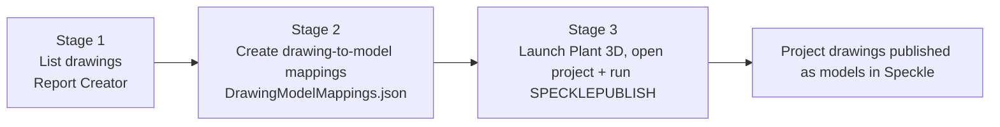
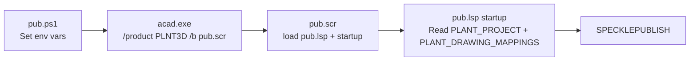
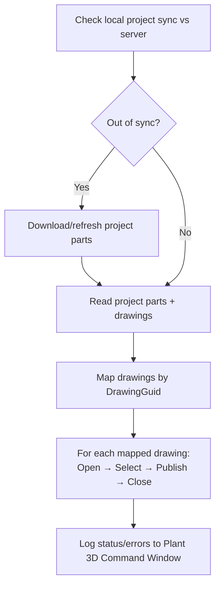
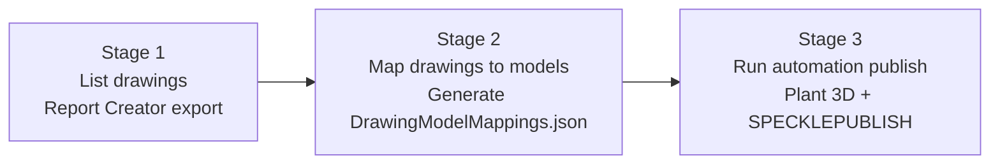

# Plant 3D Automation Connector

## Overview

The Plant 3D Automation Connector provides automated publishing for the Speckle connector running inside the Plant 3D desktop application.

Plant 3D cannot be automated as a headless application because P&ID data is only accessible from the desktop application. Full automation runs Plant 3D from a script, opens a project, and executes the `SPECKLEPUBLISH` command.

Mapped drawings can be published to destination models across different Speckle workspaces and projects.

## Prerequisites

- Autodesk AutoCAD Plant 3D installed.
- Access to a Plant 3D project (`Project.xml`).
- A drawing-to-model mapping file.
- Speckle access to the destination workspace/project/model.
- (Optional, for mapping generation) Plant 3D Report Creator.

## Quick Start

### Diagram: End-to-end automation context



### 1) Set required environment variables

```powershell
$env:PLANT_PROJECT = "C:\Users\<User>\AppData\Local\Autodesk\AutoCAD Plant 3D\CollaborationCache\<Project>\Project.xml"
$env:PLANT_DRAWING_MAPPINGS = "C:\git\SpeckleModelSync\bin\Debug\net10.0\DrawingModelMappings.json"
```

### 2) Launch Plant 3D with startup script

```powershell
& "C:\Program Files\Autodesk\AutoCAD 2026\acad.exe" `
    /product PLNT3D `
    /b "C:\git\speckle-sharp-connectors-jacobs\Connectors\Autocad\Speckle.Connectors.Plant3dShared\Automation\pub.scr"
```

### 3) Script execution chain

1. `pub.scr` loads `pub.lsp`.
2. `startup` reads environment variables.
3. `startup` opens the Plant project.
4. `startup` runs `SPECKLEPUBLISH`.

### 4) Verify completion

Review the Plant 3D Command Window for publishing progress, errors, and the published version message.

## Script Reference

### Diagram: Script launch and command handoff



### `pub.ps1` (launcher)

Responsibilities:
- Set required environment variables.
- Start `acad.exe` with `PLNT3D` product and startup script.

```powershell
$env:PLANT_PROJECT = "C:\Users\SuttonS4\AppData\Local\Autodesk\AutoCAD Plant 3D\CollaborationCache\Plant3D_Speckle\Project.xml"
$env:PLANT_DRAWING_MAPPINGS = "C:\git\SpeckleModelSync\bin\Debug\net10.0\DrawingModelMappings.json"

& "C:\Program Files\Autodesk\AutoCAD 2026\acad.exe" `
    /product PLNT3D `
    /b "C:\git\speckle-sharp-connectors-jacobs\Connectors\Autocad\Speckle.Connectors.Plant3dShared\Automation\Scripts\pub.scr"
```

### `pub.scr` (Plant 3D startup script)

Responsibilities:
- Load the AutoLISP automation script.
- Invoke startup entrypoint.

```lisp
(load "C:/git/speckle-sharp-connectors-jacobs/Connectors/Autocad/Speckle.Connectors.Plant3dShared/Automation/pub.lsp")
(startup)
```

### `pub.lsp` (AutoLISP automation entrypoint)

Responsibilities:
- Read required environment variables.
- Open project.
- Execute `SPECKLEPUBLISH`.
- Print errors for missing inputs.

```lisp
(defun startup ()

  ;; Read environment variables
  (setq project (getenv "PLANT_PROJECT"))
  (setq mappings (getenv "PLANT_DRAWING_MAPPINGS"))

  (if (and project mappings)
    (progn
      (princ (strcat "\nProject=" project))
      (princ "\nOpening Plant project...\n")

      ;; Double-open workaround sometimes required
      (command "-openproject" project)
      (command "-openproject" project)

      (command "SPECKLEPUBLISH")

      (princ "\nAutomation complete. Check for published version message.\n")
    )
    ;; Else print out the missing variables
    (progn
      (if (not project) (princ "\nERROR: PLANT_PROJECT environment variable is not set.\n"))
      (if (not mappings) (princ "\nERROR: PLANT_DRAWING_MAPPINGS environment variable is not set.\n"))
    )
  )
)

(defun c:STARTUP ()
  (startup)
)
```

## Environment Variables

### `PLANT_PROJECT` (required)
Path to Plant 3D `Project.xml` to open before publish.

### `PLANT_DRAWING_MAPPINGS` (required)
Path to mapping JSON used by `SPECKLEPUBLISH` to resolve drawing destinations.

If either variable is missing, startup prints an error to the Command Window and publishing does not proceed.

## Mapping File Contract

The mapping file can contain many fields, but the automated publish flow requires at least:

- `DrawingGuid` - identifies the drawing in the Plant 3D project.
- `ModelId` - identifies the destination model in Speckle.
- `ProjectId` - identifies the destination Speckle project.
- `AccountId` - identifies the destination Speckle account.

Example full mapping output:

```json
[
  {
    "DrawingGuid": "943a6a4c-6357-433d-99dc-f6631ee336b6",
    "RelativePath": "Plant 3D Models\\JAC-L-40-00-002.dwg",
    "ModelId": "234e9da2cb",
    "ModelName": "Plant 3D Models/JAC-L-40-00-002",
    "ProjectId": "e7ae24fb7b",
    "WorkspaceId": "d6e3044f69",
    "WorkspaceSlug": "lifesciences",
    "AccountId": "458A1B4F1ACA1CDFCA186353B627F1F8",
    "ServerUrl": "https://design.jacobs.com"
  }
]
```

## SPECKLEPUBLISH Workflow (Internals)

### Diagram: `SPECKLEPUBLISH` execution loop



`SPECKLEPUBLISH` performs the following:

When the project is opened in Plant 3D, the local project state is expected to be refreshed automatically before synchronization checks run.

1. Validates project synchronization with server state.
2. Reads Plant 3D project parts (for example, P&ID and Plant 3D).
3. Checks drawing versions and downloads project parts if local data is out of sync.
4. Maps project drawings to Speckle models by drawing GUID.
5. For each mapped drawing:
   - Opens and activates the drawing.
   - Selects drawing objects.
   - Prepares a sender model card for destination routing.
   - Publishes to Speckle.
   - Waits for completion and reports errors.
   - Closes the drawing and continues.

Messages and errors are logged to the Plant 3D Command Window. Plant 3D is not closed automatically after publish.

The current logging flow targets the Command Window. If required, this can be extended to also write logs to an output file.

## Mapping Generation Process

### Diagram: End-to-end automation stages



This proof-of-concept process has two stages:

1. List drawings in a Plant 3D project.
2. Map drawings to Speckle models and generate mapping JSON.

### Stage 1: List drawings

Use Plant 3D Report Creator to export a tab-delimited file containing:

- This can be run without opening the project in Plant 3D.
- The report uses the local project file, which may be out of sync with the server.

Dependencies:

- Up-to-date Plant 3D project file.
- Plant 3D Report Creator.
- Report template for output export.

Output:

- Tab-delimited drawing list (name, path, and GUID).

The export includes:

- Drawing Name
- Relative Path
- Drawing GUID

Example output:

```text
Drawing Name        Relative Path                                          Drawing GUID
JAC-L-40-00-002.dwg Plant 3D Models\JAC-L-40-00-002.dwg                   {943a6a4c-6357-433d-99dc-f6631ee336b6}
SAM-T0001.dwg       Plant 3D Models\TestFolder\TestSubFolder\SAM-T0001.dwg {216bce4f-87c3-4506-893f-f3af3a380f53}
SAM-T0001.dwg       PID DWG\SAM-T0001.dwg                                 {72a68fb3-6f9d-4569-8133-e8969889c09b}
```

The Report Creator can be automated:

```powershell
$Project = "C:\Users\SuttonS4\AppData\Local\Autodesk\AutoCAD Plant 3D\CollaborationCache\Plant3D_Speckle\Project.xml"
$Config  = "C:\ProgramData\Autodesk\Autodesk AutoCAD Plant 3D 2026\R25.1\enu\ReportCreator\ReportFiles\DrawingListExport.rcfx"
$exe = "C:\Program Files\Autodesk\AutoCAD 2026\PLNT3D\PnPReportCreator.exe"

$process = Start-Process -FilePath $exe -Wait -PassThru `
    -ArgumentList "/PROJECT `"$Project`" /CONFIG `"$Config`" /HIDDEN /QUIET"

if ($process.ExitCode -ne 0) {
    throw "PnPReportCreator failed with exit code $($process.ExitCode)"
}
```

### Stage 2: Map drawings to models

Current proof-of-concept behavior:

- Reads drawing list output from Stage 1.
- Reads projects/models from the Life Sciences Speckle workspace.
- Converts drawing relative path separators (`\`) to model hierarchy separators (`/`) when matching names.
- Creates placeholder models when needed.
- Writes `DrawingModelMappings.json` for automated publish.

Note:

- In Speckle, `/` represents related submodels and is shown in the UI as a pseudo-folder structure.

Dependencies:

- Report of drawings from Stage 1.
- Speckle connection.
- Speckle permissions to list projects, and list/create models in the workspace.

Output:

- Drawing-to-model mapping file (`DrawingModelMappings.json`).

## Troubleshooting

- `PLANT_PROJECT` missing: startup prints error and exits publish flow.
- `PLANT_DRAWING_MAPPINGS` missing: startup prints error and exits publish flow.
- Local project out of sync: connector attempts to refresh/download project parts before publishing.
- Missing model mapping: drawing will not be routed to destination model.
- Permission issues: ensure account can list projects/models and create models where required.

## References

### ACAD.exe command parameters

- https://www.cadforum.cz/en/overview-of-startup-parameters-for-acad-exe-and-acadlt-exe-tip14753
- https://help.autodesk.com/view/ACD/2026/ENU/?guid=GUID-8E54B6EC-5B52-4F62-B7FC-0D4E1EDF093A
