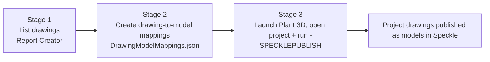
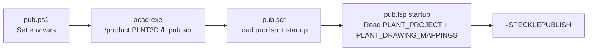
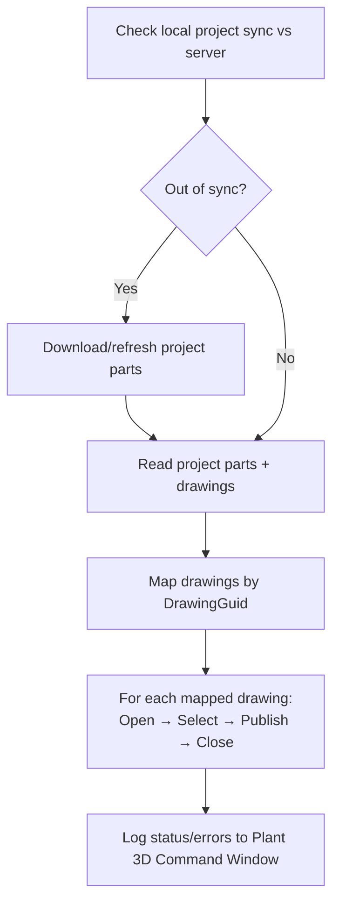
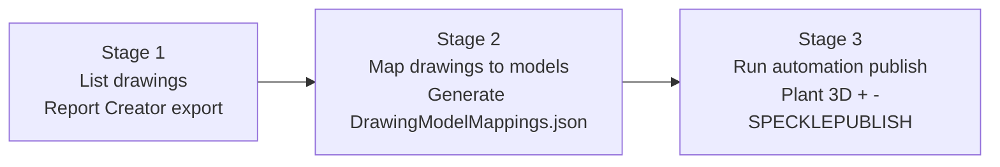

# Plant 3D Automation Connector

## Overview

The Plant 3D Automation Connector provides automated publishing for the Speckle connector running inside the Plant 3D desktop application.

Plant 3D cannot be automated as a headless application because P&ID data is only accessible from the desktop application. Full automation runs Plant 3D from a script, opens a project, and executes the `-SPECKLEPUBLISH` batch command.

Mapped drawings can be published to destination models across different Speckle workspaces and projects.

## Prerequisites

- Autodesk AutoCAD Plant 3D installed.
- Access to a Plant 3D project (`Project.xml`).
- A drawing-to-model mapping file.
- Speckle access to the destination workspace/project/model.
- (Optional, for mapping generation) Plant 3D Report Creator.
- The automation `Scripts` folder added to the Plant 3D trusted locations (see below).

### Trust the scripts folder

Plant 3D only loads AutoLISP files (`pub.lsp`) without a security prompt when they are in a trusted location. An untrusted folder shows a load warning dialog that blocks an unattended run until it times out.

Add the `Scripts` folder once per machine and user profile:

1. In Plant 3D, open the application menu and select **Options**.
2. On the **Files** tab, expand **Trusted Locations** and click **Add**.
3. Browse to the scripts folder, for example `C:\git\speckle-sharp-connectors-fork\Connectors\Autocad\Speckle.Connectors.Plant3dShared\Automation\Scripts`.
4. Click **OK** and confirm.

The setting is stored in the Plant 3D profile (`TRUSTEDPATHS` system variable). Repeat it if the scripts are moved, the repository is cloned elsewhere or a different Windows user or Plant 3D profile runs the automation.

## Quick Start

### Diagram: End-to-end automation context



### 1) Set required environment variables

```powershell
$env:PLANT_PROJECT = "C:\Users\<User>\AppData\Local\Autodesk\AutoCAD Plant 3D\CollaborationCache\<Project>\Project.xml"
$env:PLANT_DRAWING_MAPPINGS = "C:\git\SpeckleModelSync\bin\Debug\net10.0\DrawingModelMappings.json"
```

### 2) Launch Plant 3D with startup script

```powershell
& "C:\Program Files\Autodesk\AutoCAD 2026\acad.exe" `
    /product PLNT3D `
    /b "C:\git\speckle-sharp-connectors-jacobs\Connectors\Autocad\Speckle.Connectors.Plant3dShared\Automation\pub.scr"
```

### 3) Script execution chain

1. `pub.scr` loads `pub.lsp`.
2. `startup` reads environment variables.
3. `startup` opens the Plant project.
4. `startup` runs `-SPECKLEPUBLISH`.

### 4) Verify completion

Review the Plant 3D Command Window for publishing progress, errors, and the published version message.

## Script Reference

### Diagram: Script launch and command handoff



### `pub.ps1` (launcher)

Responsibilities:
- Set required environment variables.
- Start `acad.exe` with `PLNT3D` product and startup script.

```powershell
$env:PLANT_PROJECT = "C:\Users\SuttonS4\AppData\Local\Autodesk\AutoCAD Plant 3D\CollaborationCache\Plant3D_Speckle\Project.xml"
$env:PLANT_DRAWING_MAPPINGS = "C:\git\SpeckleModelSync\bin\Debug\net10.0\DrawingModelMappings.json"

& "C:\Program Files\Autodesk\AutoCAD 2026\acad.exe" `
    /product PLNT3D `
    /b "C:\git\speckle-sharp-connectors-jacobs\Connectors\Autocad\Speckle.Connectors.Plant3dShared\Automation\Scripts\pub.scr"
```

### `pub.scr` (Plant 3D startup script)

Responsibilities:
- Load the AutoLISP automation script.
- Invoke startup entrypoint.

```lisp
(load (strcat (getenv "PLANT_PUBLISH_SCRIPTS_DIR") "\\pub.lsp"))
(startup)
```

### `pub.lsp` (AutoLISP automation entrypoint)

Responsibilities:
- Read required environment variables.
- Open project.
- Execute `-SPECKLEPUBLISH`.
- Print errors for missing inputs.

```lisp
(defun startup ()

  ;; Read environment variables
  (setq project (getenv "PLANT_PROJECT"))
  (setq mappings (getenv "PLANT_DRAWING_MAPPINGS"))

  (if (and project mappings)
    (progn
      (princ (strcat "\nProject=" project))
      (princ "\nOpening Plant project...\n")

      ;; Double-open workaround sometimes required
      (command "-openproject" project)
      (command "-openproject" project)

      ;; The batch command writes the result file and closes Plant 3D when it finishes.
      (command "-SPECKLEPUBLISH")
    )
    ;; Else print out the missing variables
    (progn
      (if (not project) (princ "\nERROR: PLANT_PROJECT environment variable is not set.\n"))
      (if (not mappings) (princ "\nERROR: PLANT_DRAWING_MAPPINGS environment variable is not set.\n"))
    )
  )
)

(defun c:STARTUP ()
  (startup)
)
```

## Environment Variables

### Script and launcher variables

These variables are used by the launcher chain (`pub.ps1` -> `pub.scr` -> `pub.lsp`) to start Plant 3D, open the project and run the batch command.

| Environment variable | Set by | Read by | Purpose |
|---|---|---|---|
| `PLANT_PROJECT` | User, in `pub.ps1` | `pub.lsp` (and `pub.ps1` to derive the run ID) | Path to the Plant 3D `Project.xml` opened with `-OPENPROJECT` before publishing. |
| `PLANT_DRAWING_MAPPINGS` | User, in `pub.ps1` | `pub.lsp` (presence check) and both publish commands | Path to the drawing-to-model mapping JSON used to resolve drawing destinations. |
| `PLANT_PUBLISH_SCRIPTS_DIR` | `pub.ps1` automatically (`$PSScriptRoot`) | `pub.scr` | Folder containing `pub.lsp`. AutoCAD script files cannot resolve paths relative to themselves, so `pub.scr` loads `pub.lsp` from this folder. Do not set it manually. |

If `PLANT_PROJECT` or `PLANT_DRAWING_MAPPINGS` is missing, `pub.lsp` prints an error to the Command Window and does not run `-SPECKLEPUBLISH`. If `PLANT_PUBLISH_SCRIPTS_DIR` is missing (for example, `pub.scr` launched without `pub.ps1`), `pub.lsp` cannot be loaded.

#### Relevance to the interactive and batch commands

| Environment variable | Interactive `SPECKLEPUBLISH` | Batch `-SPECKLEPUBLISH` |
|---|---|---|
| `PLANT_PROJECT` | Not used. Open the project in Plant 3D before running the command. | Not read by the command. `pub.lsp` uses it to open the project before running the command. |
| `PLANT_DRAWING_MAPPINGS` | Optional. The user is always asked to confirm the mappings path. When set, it is offered as the default; otherwise the default is `%ProgramData%\Speckle\Connectors\Plant3D\DrawingModelMappings.json`. Answering `No` prompts for a path. | Required. No prompt is shown; if it is not set, the run ends with a configuration error (`ConfigError` result status). |
| `PLANT_PUBLISH_SCRIPTS_DIR` | Not used. | Not read by the command. Only used by `pub.scr` to load `pub.lsp`. |

### Publish command options

These environment variables are read by both publish commands:

- Interactive command: `SPECKLEPUBLISH`
- Batch command: `-SPECKLEPUBLISH`

| Environment variable | Interactive `SPECKLEPUBLISH` behavior | Batch `-SPECKLEPUBLISH` behavior | Default |
|---|---|---|---|
| `PLANT_PUBLISH_FORCE` | If set, no prompt is shown and value controls force mode (`true`/`1` = on). If not set, the user is prompted `Yes/No`. | No prompts. Value controls force mode (`true`/`1` = on). | `false` unless user selects `Yes` in interactive mode. |
| `PLANT_PUBLISH_RUN_ID` | Optional. If not set, an `interactive-<UTC timestamp>` run ID is generated and used for logging/result naming. Interactive runs do not write the run ID into version tags. | Intended to be set by the launcher script for per-run result and retry correlation. | `interactive-<UTC timestamp>` when missing. |
| `PLANT_PUBLISH_DEADLINE_UTC` | Optional hard deadline (`DateTimeOffset` value). When missing/invalid there is no deadline. | Optional hard deadline. When missing/invalid, batch applies a default deadline of startup time + 120 minutes and logs a warning. | None for interactive; `+120 minutes` fallback in batch. |
| `PLANT_PUBLISH_DRAWING_RETRIES` | Extra per-drawing retries for transient failures. | Extra per-drawing retries for transient failures. | `2` when missing/invalid. |

## Mapping File Contract

The mapping file can contain many fields, but the automated publish flow requires at least:

- `DrawingGuid` - identifies the drawing in the Plant 3D project.
- `ModelId` - identifies the destination model in Speckle.
- `ProjectId` - identifies the destination Speckle project.
- `AccountId` - identifies the destination Speckle account.

Example full mapping output:

```json
[
  {
    "DrawingGuid": "943a6a4c-6357-433d-99dc-f6631ee336b6",
    "RelativePath": "Plant 3D Models\\JAC-L-40-00-002.dwg",
    "ModelId": "234e9da2cb",
    "ModelName": "Plant 3D Models/JAC-L-40-00-002",
    "ProjectId": "e7ae24fb7b",
    "WorkspaceId": "d6e3044f69",
    "WorkspaceSlug": "lifesciences",
    "AccountId": "458A1B4F1ACA1CDFCA186353B627F1F8",
    "ServerUrl": "https://design.jacobs.com"
  }
]
```

## SPECKLEPUBLISH Workflow (Internals)

### Diagram: `SPECKLEPUBLISH` execution loop



`SPECKLEPUBLISH` performs the following:

When the project is opened in Plant 3D, the local project state is expected to be refreshed automatically before synchronization checks run.

1. Validates project synchronization with server state.
2. Reads Plant 3D project parts (for example, P&ID and Plant 3D).
3. Checks drawing versions and downloads project parts if local data is out of sync.
4. Maps project drawings to Speckle models by drawing GUID.
5. For each mapped drawing:
   - Opens and activates the drawing.
   - Selects drawing objects.
   - Prepares a sender model card for destination routing.
   - Publishes to Speckle.
   - Waits for completion and reports errors.
   - Closes the drawing and continues.

Messages and errors are logged to the Plant 3D Command Window. Plant 3D is not closed automatically after publish.

The current logging flow targets the Command Window. If required, this can be extended to also write logs to an output file.

## Mapping Generation Process

### Diagram: End-to-end automation stages



This proof-of-concept process has two stages:

1. List drawings in a Plant 3D project.
2. Map drawings to Speckle models and generate mapping JSON.

### Stage 1: List drawings

Use Plant 3D Report Creator to export a tab-delimited file containing:

- This can be run without opening the project in Plant 3D.
- The report uses the local project file, which may be out of sync with the server.

Dependencies:

- Up-to-date Plant 3D project file.
- Plant 3D Report Creator.
- Report template for output export.

Output:

- Tab-delimited drawing list (name, path, and GUID).

The export includes:

- Drawing Name
- Relative Path
- Drawing GUID

Example output:

```text
Drawing Name        Relative Path                                          Drawing GUID
JAC-L-40-00-002.dwg Plant 3D Models\JAC-L-40-00-002.dwg                   {943a6a4c-6357-433d-99dc-f6631ee336b6}
SAM-T0001.dwg       Plant 3D Models\TestFolder\TestSubFolder\SAM-T0001.dwg {216bce4f-87c3-4506-893f-f3af3a380f53}
SAM-T0001.dwg       PID DWG\SAM-T0001.dwg                                 {72a68fb3-6f9d-4569-8133-e8969889c09b}
```

The Report Creator can be automated:

```powershell
$Project = "C:\Users\SuttonS4\AppData\Local\Autodesk\AutoCAD Plant 3D\CollaborationCache\Plant3D_Speckle\Project.xml"
$Config  = "C:\ProgramData\Autodesk\Autodesk AutoCAD Plant 3D 2026\R25.1\enu\ReportCreator\ReportFiles\DrawingListExport.rcfx"
$exe = "C:\Program Files\Autodesk\AutoCAD 2026\PLNT3D\PnPReportCreator.exe"

$process = Start-Process -FilePath $exe -Wait -PassThru `
    -ArgumentList "/PROJECT `"$Project`" /CONFIG `"$Config`" /HIDDEN /QUIET"

if ($process.ExitCode -ne 0) {
    throw "PnPReportCreator failed with exit code $($process.ExitCode)"
}
```

### Stage 2: Map drawings to models

Current proof-of-concept behavior:

- Reads drawing list output from Stage 1.
- Reads projects/models from the Life Sciences Speckle workspace.
- Converts drawing relative path separators (`\`) to model hierarchy separators (`/`) when matching names.
- Creates placeholder models when needed.
- Writes `DrawingModelMappings.json` for automated publish.

Note:

- In Speckle, `/` represents related submodels and is shown in the UI as a pseudo-folder structure.

Dependencies:

- Report of drawings from Stage 1.
- Speckle connection.
- Speckle permissions to list projects, and list/create models in the workspace.

Output:

- Drawing-to-model mapping file (`DrawingModelMappings.json`).

## Changed-Only Publishing

Unchanged drawings are not opened in Plant 3D; their file is only read (read-only) to compute the hash.

A drawing is published when any of these is true:

- force is active (`PLANT_PUBLISH_FORCE` or `alwaysPublish` on the mapping);
- the model's latest version has no fingerprint (never published by this feature);
- the fingerprint's schema differs from `Plant3dPublishSchema.VERSION`;
- the fingerprint's SHA-256 differs from the drawing file's SHA-256.

The fingerprint is stored on the server in the version message, e.g. `[speckle-plant3d sha256=<HEX> schema=1]`, so no local state is kept. If the server cannot be reached the drawing is skipped and reported as an error.

| Environment variable | Purpose |
|---|---|
| `PLANT_PUBLISH_FORCE` | `true`/`1` publishes every mapped drawing once per run. |
| `PLANT_PUBLISH_DRAWING_RETRIES` | Extra per-drawing retries for transient failures (default `2`). |

Per-mapping force: add `"alwaysPublish": true` to a mapping in `DrawingModelMappings.json`.

Developers: increment `Plant3dPublishSchema.VERSION` when converter output, root object structure or published properties change, so every drawing is republished.

If tagging a version fails after a successful publish, that drawing is simply published again on the next run.

## Troubleshooting

- `PLANT_PROJECT` missing: startup prints error and exits publish flow.
- `PLANT_DRAWING_MAPPINGS` missing: startup prints error and exits publish flow.
- Security warning when loading `pub.lsp`, or the run hangs until it times out: the `Scripts` folder is not a trusted location. See [Trust the scripts folder](#trust-the-scripts-folder).
- Local project out of sync:
- Missing model mapping: drawing will not be routed to destination model.
- Permission issues: ensure account can list projects/models and create models where required.

## References

### ACAD.exe command parameters

- https://www.cadforum.cz/en/overview-of-startup-parameters-for-acad-exe-and-acadlt-exe-tip14753
- https://help.autodesk.com/view/ACD/2026/ENU/?guid=GUID-8E54B6EC-5B52-4F62-B7FC-0D4E1EDF093A
